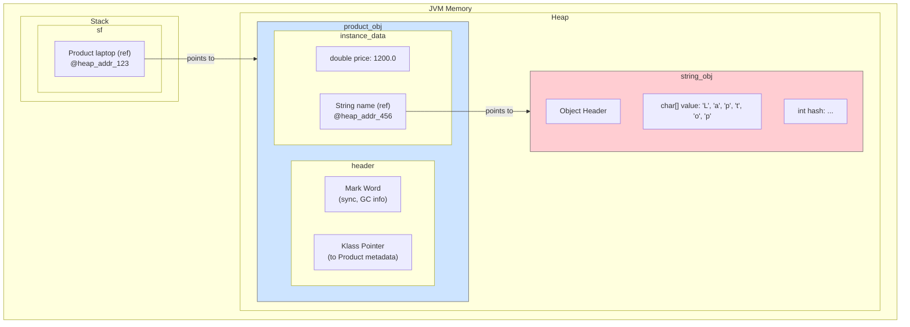
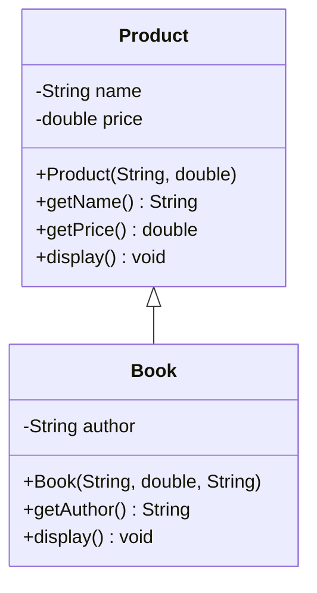

# 03 - Object-Oriented Programming: Building with Blueprints

> **Authors' Note:** Object-Oriented Programming (OOP) was at the very heart of our design for Java. We wanted to give you a way to model the real world in your code, to create "objects" that have both data (state) and behavior (methods). This chapter is your guide to thinking in objects.

**What's in this chapter:**

*   [The Core Idea: Classes and Objects](#1-classes-and-objects-blueprints-and-buildings)
*   [The Four Pillars of OOP](#2-the-four-pillars-of-oop-our-design-philosophy)
*   [Your Mission: Build an E-commerce System](#3-your-mission-build-an-e-commerce-system)
*   [Interview Deep Dives](#interview-deep-dives)

---

## 1. Classes and Objects: Blueprints and Buildings

The fundamental concept of OOP is the distinction between a **class** and an **object**.

*   **Class:** A class is the **blueprint**. It defines the structure (fields) and behavior (methods) of a type of object. It's an abstract concept.
*   **Object:** An object is the **actual building** created from the blueprint. It's a concrete *instance* of a class, with its own state.

Let's model a `Product` in our e-commerce application. A good `Product` class should encapsulate its data, hiding the internal details from the outside world.

```java
// Product.java

public class Product {
    // --- Private instance variables (the object's state) ---
    // By making these 'private', we protect them from the outside world.
    private String name;
    private double price;

    // --- Constructor: A special method for creating objects ---
    // Its job is to initialize the state of the new object.
    public Product(String name, double price) {
        this.name = name;
        this.price = price;
    }

    // --- Getter methods (accessors) ---
    // These provide controlled, read-only access to the private data.
    public String getName() {
        return name;
    }

    public double getPrice() {
        return price;
    }

    // --- Public method (the object's behavior) ---
    public void display() {
        System.out.println(name + ": $" + price);
    }
}
```

When you create an object (instantiate a class), you use the `new` keyword and the constructor to provide the initial state.

```java
// Creating an instance of the Product class
Product laptop = new Product("Laptop", 1200.00);

// Calling a public method on the object
laptop.display(); // Output: Laptop: $1200.0
```

### JVM Deep Dive: Object Layout on the Heap

When `new Product("Laptop", 1200.00)` is executed, here's what happens inside the JVM, step by step:

1.  **Memory Allocation:** The JVM allocates a chunk of memory on the **heap** for the `Product` object. The size is determined by the fields in the class.
2.  **Object Header:** The first part of this memory chunk is the *Object Header*. This isn't something you can access directly in your Java code, but it's crucial for the JVM. It contains:
    *   **Mark Word:** Used for synchronization (locking) and garbage collection information.
    *   **Klass Pointer:** A reference to the class's metadata in the Metaspace, which tells the JVM everything it needs to know about the `Product` class (its methods, field names, etc.).
3.  **Instance Data:** The actual data for the object's fields (`name` and `price`).
    *   The `price` (a `double`) is a primitive type, so its 8 bytes are stored directly in the object's memory block.
    *   The `name` is a reference type. The variable `name` itself is just a pointer (a memory address) that points to a `String` object, which also lives on the heap. The string "Laptop" is a separate object!

Here is a simplified visualization:



---

## 2. The Four Pillars of OOP: Our Design Philosophy

We designed Java around four core principles that we believed were essential for building robust, scalable, and maintainable software. These are not just academic concepts; they are practical tools that help you write better code.

### a. Encapsulation: The Protective Capsule

**Encapsulation** is the practice of bundling an object's data (fields) and the methods that operate on that data into a single unit (a class). It also involves hiding the internal state of the object from the outside world.

**The Goal:** To protect an object from accidental or unauthorized modification. It's a defensive strategy that makes your code more robust.

**The Analogy: A Medical Capsule**
Think of a medical capsule. The plastic casing (the `public` methods) protects the medicine inside (the `private` data). You don't need to know the chemical formula of the medicine to use it; you just swallow the capsule. It's a self-contained unit that protects its internal state.

```mermaid
graph TD
    subgraph "Product Class (The Capsule)"
        direction LR

        subgraph "Internal State (Private Data)"
            direction TB
            name["String name"]
            price["double price"]
        end

        subgraph "Public Interface (Public Methods)"
            direction TB
            getName["getName()"]
            getPrice["getPrice()"]
            display["display()"]
        end

        style `Internal State (Private Data)` fill:#ffcdd2,stroke:#c62828,stroke-width:2px
    end

    outside_world("External Code")

    outside_world -- "Allowed Access" --> getName
    outside_world -- "Allowed Access" --> getPrice
    outside_world -- "Allowed Access" --> display
    outside_world -- "Blocked Access" --x name
    outside_world -- "Blocked Access" --x price

    note["External code can only interact with the public methods, not the private data."]
```

### b. Inheritance: The Family Tree

**Inheritance** allows you to create a new class (a *subclass* or *child class*) that inherits the properties and methods of an existing class (a *superclass* or *parent class*).

**The Goal:** To promote code reuse and create a logical hierarchy. This is the **"is-a"** relationship in OOP.

**The Analogy: A Family Tree**
A child inherits traits like eye color and height from their parents. In OOP, a child class inherits fields and methods from its parent class. A `Book` *is a* `Product` and inherits its name and price.

```java
// Book.java
// 'Book' is the subclass, 'Product' is the superclass.
public class Book extends Product {
    private String author;

    public Book(String name, double price, String author) {
        // 'super()' calls the constructor of the superclass (Product)
        // to initialize the inherited fields.
        super(name, price);
        this.author = author;
    }

    public String getAuthor() {
        return author;
    }

    // We can also @Override methods from the parent class.
    @Override
    public void display() {
        // We can reuse the parent's method, then add our own info.
        super.display();
        System.out.println("Author: " + author);
    }
}
```

A `Book` object now has its own fields (`author`) plus the inherited fields (`name`, `price`).

Here's how this relationship looks:



### c. Polymorphism: The Universal Remote

**Polymorphism** (from Greek, meaning "many forms") is the ability of an object to take on many forms. In Java, it means you can use a superclass reference to refer to a subclass object.

**The Goal:** To write more flexible and decoupled code. You can write code that works with a general type (like `Product`) without needing to know the specific subtype (like `Book` or `Clothing`).

**The Analogy: A Universal Remote**
A universal remote has a single "Power" button. Depending on whether you point it at a TV, a Blu-ray player, or a sound system, that *same button* performs a different action.

```mermaid
graph TD
    subgraph "Polymorphism: The Universal Remote"
        remote("Universal Remote")

        subgraph "Devices"
            tv("TV")
            soundbar("Soundbar")
            console("Game Console")
        end

        subgraph "Actions"
            tv_power["TV Power On/Off"]
            soundbar_power["Soundbar Power On/Off"]
            console_power["Console Power On/Off"]
        end

        remote -- "pressPower()" --> tv
        remote -- "pressPower()" --> soundbar
        remote -- "pressPower()" --> console

        tv -- "executes" --> tv_power
        soundbar -- "executes" --> soundbar_power
        console -- "executes" --> console_power

        style remote fill:#cde4ff,stroke:#666
    end

    note["`device.pressPower()` calls the correct method for the actual object."]
```

In Java, this means you can have a single method name (`display()`) that behaves differently depending on the actual object it's called on (`Product`, `Book`, `Clothing`).

```java
// The variable is of type Product, but the object is a Book.
Product myProduct = new Book("The Pragmatic Programmer", 45.00, "Andy Hunt");

// The JVM knows it's actually a Book at runtime, so it calls the Book's display() method!
myProduct.display();
```

This is called **runtime polymorphism** or **dynamic method dispatch**.

#### JVM Deep Dive: Virtual Method Tables (vtables)

How does the JVM know which `display()` method to call? This is implemented using something called a "virtual method table" or "vtable".

Every class has a vtable that contains the memory addresses of its methods. When a subclass like `Book` overrides a method, the JVM updates the vtable for `Book` to point to the new, overridden method.

```mermaid
graph TD
    subgraph "JVM Internals: Virtual Method Tables (vtables)"
        subgraph "Class Metadata (in Metaspace)"
            product_vtable["Product vtable"]
            subgraph product_vtable
                product_display["display() -> @addr_product_display"]
                product_getprice["getPrice() -> @addr_product_getprice"]
            end

            book_vtable["Book vtable"]
            subgraph book_vtable
                book_display["display() -> @addr_book_display (Overridden)"]
                book_getprice["getPrice() -> @addr_product_getprice (Inherited)"]
                book_getauthor["getAuthor() -> @addr_book_getauthor"]
            end
        end

        subgraph "Heap Memory"
            product_obj["Product myProduct = new Book(...)"]
            product_obj -- "refers to" --> book_instance
            book_instance["Book Object"]
            book_instance -- "has a pointer to" --> book_vtable
        end

        subgraph "Code Execution"
            call["myProduct.display()"]
            call -- "1. JVM checks actual object (Book)" --> book_instance
            book_instance -- "2. JVM looks up vtable" --> book_vtable
            book_vtable -- "3. Finds overridden method" --> book_display
        end

        style book_display fill:#ffcdd2,stroke:#c62828
    end
```

When you call `myProduct.display()`, the JVM looks at the actual object (`Book`), consults its vtable, and calls the overridden `display()` method.

### d. Abstraction: The Car Dashboard

**Abstraction** is about hiding the implementation details and showing only the essential features.

**The Goal:** To reduce complexity and isolate the impact of changes.

**The Analogy: A Car's Dashboard**
When you drive a car, you use a simple interface: a steering wheel, pedals, and a gear stick. You don't need to know about the engine's combustion cycle or the transmission's inner workings. Abstraction hides the complex reality behind a simple interface.

```mermaid
graph TD
    subgraph "Abstraction: The Car"
        subgraph "Simple Interface (What you see)"
            dashboard["Dashboard"]
            subgraph dashboard
                steering_wheel["Steering Wheel"]
                pedals["Pedals"]
                gear_stick["Gear Stick"]
            end
        end

        subgraph "Complex Reality (What's hidden)"
            engine["Engine"]
            transmission["Transmission"]
            electronics["Electronics"]
        end

        dashboard -- "Controls" --> engine
        dashboard -- "Controls" --> transmission
        dashboard -- "Controls" --> electronics

        style `Complex Reality (What's hidden)` fill:#e0e0e0,stroke:#616161,stroke-dasharray: 5 5
    end

    driver("Driver")
    driver -- "Interacts with" --> dashboard

    note["The driver uses a simple interface without needing to know the complex details underneath."]
```

We provided two main ways to achieve this in Java: **abstract classes** and **interfaces**. We'll dive deeper into these in the next chapter, but the core idea is to define a contract without a concrete implementation.

---

### Check Your Understanding

**Question 1:** If a `Car` class has a private field `int speed`, what principle of OOP prevents you from writing `myCar.speed = 100;` from outside the `Car` class?
<details>
  <summary>Answer</summary>
  **Encapsulation.** The data (`speed`) is hidden, and you should only be able to modify it through public methods (like `myCar.setSpeed(100);`). This protects the `Car` object from being put into an invalid state (e.g., a negative speed).
</details>

**Question 2:** You have a `Product` variable, but it holds a `Book` object (`Product p = new Book(...)`). When you call `p.display()`, which `display` method is executed—the one from `Product` or the one from `Book`? What is this principle called?
<details>
  <summary>Answer</summary>
  The `display` method from the **`Book`** class is executed. This is called **Polymorphism**. The JVM determines the correct method to call at runtime based on the actual object type, not the reference type.
</details>

**Question 3:** What is the key difference between Inheritance and Encapsulation?
<details>
  <summary>Answer</summary>
  **Inheritance** is about creating a hierarchy and reusing code from a parent class (an "is-a" relationship). **Encapsulation** is about bundling data and methods together and hiding the data to protect it (a "black box" principle).
</details>

---

## 3. Your Mission: Build an E-commerce System

It's time to apply these pillars of OOP. We've created a small, runnable Maven project in the `code/` subdirectory that includes the `Product` and `Book` classes. Your mission is to extend this system.

**Part 1: Create a `Clothing` class**
1.  **Find the Code:** Open the `code/src/main/java/com/tenx/oop/` directory.
2.  **Create a New File:** Create a new Java class file named `Clothing.java`.
3.  **Accept the Challenge:**
    *   Make the `Clothing` class inherit from `Product`.
    *   Add two private fields: `String size` and `String color`.
    *   Create a constructor that initializes all fields, including the inherited ones from `Product`.
    *   Override the `display()` method to print the name, price, size, and color.

**Part 2: Test with Polymorphism**
1.  **Open `Main.java`:** This is the entry point of our application.
2.  **Create an Array:** Create an array or `ArrayList` of `Product`.
3.  **Add Your Objects:** Add a `Product` instance, a `Book` instance, and your new `Clothing` instance to the list.
4.  **Loop and Display:** Loop through the list and call the `display()` method on each object. Observe how polymorphism works—the correct `display()` method is called for each object type!

**Bonus Mission: The `final` Keyword**

What happens if you declare a method as `final` in the `Product` class? Try adding `final` to the `getPrice()` method. Can the `Book` class still override it? What about the `Product` class itself? Can you make it `final`? What error do you see?

<details>
<summary>Stuck? Here's a solution for Part 1 & 2</summary>

**Clothing.java:**
```java
package com.tenx.oop;

public class Clothing extends Product {
    private String size;
    private String color;

    public Clothing(String name, double price, String size, String color) {
        super(name, price);
        this.size = size;
        this.color = color;
    }

    @Override
    public void display() {
        super.display();
        System.out.println("Size: " + this.size + ", Color: " + this.color);
    }
}
```

**Main.java:**
```java
package com.tenx.oop;

import java.util.ArrayList;
import java.util.List;

public class Main {
    public static void main(String[] args) {
        List<Product> products = new ArrayList<>();
        products.add(new Product("Generic Monitor", 250.00));
        products.add(new Book("Clean Code", 40.00, "Robert C. Martin"));
        products.add(new Clothing("T-Shirt", 25.00, "L", "Blue"));

        for (Product p : products) {
            p.display();
            System.out.println("-----------------");
        }
    }
}
```
</details>

---

### Key Takeaways

*   **Class vs. Object:** A **class** is a blueprint (e.g., the plan for a house). An **object** is a concrete instance created from that blueprint (e.g., an actual house).
*   **Encapsulation:** Protect your object's data by making fields `private` and providing `public` methods for access. Think of it as a protective capsule.
*   **Inheritance:** Create new classes (`subclasses`) that reuse and extend the functionality of existing classes (`superclasses`). This forms an "is-a" relationship (a `Book` is a `Product`).
*   **Polymorphism:** Allows you to treat objects of different classes in a uniform way. You can have a `Product` reference that points to a `Book` or `Clothing` object, and the correct `display()` method will be called automatically.
*   **Abstraction:** Hide complex implementation details behind a simple interface. (This will be explored more in the next chapter).

---

## Interview Deep Dives

### Q10: What is the difference between an Inner Class and a Sub-Class?

*   **Simple Answer:** A sub-class inherits from a parent class (an "is-a" relationship). An inner class is a helper class defined inside another class.
*   **Detailed Explanation:**
    *   **Sub-class (e.g., `class EBook extends Product`):** This is standard inheritance. `EBook` *is a* `Product` and inherits its public/protected members. It's used for code reuse and polymorphism.
    *   **Inner Class (e.g., `class OrderLine` inside `class Order`):** This is a class defined within another class. It's used for helper classes that are tightly coupled to the outer class. The key feature is that an inner class object has access to the private fields of its outer class object.

### Q11: What is a singleton class?

*   **Simple Answer:** A class that is designed to have only one instance.
*   **How it works:**
    1.  Make the constructor `private`.
    2.  Create a `private static final` instance of the class.
    3.  Provide a `public static` method (`getInstance()`) to return that single instance.
*   **When to use it:** For global resources like a database connection manager or a configuration loader.
*   **Caution:** Singletons can make code hard to test because they introduce global state. Modern frameworks like Spring often provide better ways to manage single instances using dependency injection.

### Q12: What is a constructor and can it be overloaded?

*   **Simple Answer:** A constructor is a special method used to create an object. And yes, it can be overloaded.
*   **Detailed Explanation:**
    *   A constructor must have the same name as the class and has no return type.
    *   Its job is to initialize the object's fields.
    *   **Overloading:** You can have multiple constructors in the same class, as long as they have different parameters. This gives you flexible ways to create objects.

### Q13: What is the difference between Method Overloading and Method Overriding?

*   **Simple Answer:** Overloading is having multiple methods with the same name but different parameters in the *same class*. Overriding is when a *child class* provides a new implementation for a method from its parent class.
*   **Detailed Explanation:**
| Feature | Method Overloading | Method Overriding |
| :--- | :--- | :--- |
| **Location** | Same class | Parent and Child class |
| **Parameters**| Must be different | Must be the same |
| **Purpose** | Convenience (multiple ways to call a method) | Polymorphism (changing behavior in a child class) |

### Q14: Why doesn't Java support multiple inheritance for classes?

*   **Simple Answer:** To avoid the "Diamond Problem".
*   **The Diamond Problem:**
    *   Imagine class `A` has a method `foo()`.
    *   Classes `B` and `C` both inherit from `A` and override `foo()`.
    *   If class `D` could inherit from both `B` and `C`, which version of `foo()` would it get? It's ambiguous.

    ```mermaid
    graph TD
        subgraph "The Diamond Problem"
            A["SuperClass<br/>foo()"]
            B["SubClassB<br/>@Override foo()"]
            C["SubClassC<br/>@Override foo()"]
            D["ConflictedClass<br/>Which foo() to inherit?"]
        end

        A -- "extends" --> B
        A -- "extends" --> C
        B -- "extends" --> D
        C -- "extends" --> D

        subgraph "Ambiguity"
            direction TD
            q{"D.foo() ?"} --> b_impl{"B.foo() implementation"}
            q --> c_impl{"C.foo() implementation"}
        end

        style D fill:#ffcdd2,stroke:#c62828,stroke-width:2px
        style q fill:#fff9c4,stroke:#f57f17,stroke-width:2px
    ```
*   **Java's Solution:** A class can only `extend` one parent class. However, a class can `implement` multiple interfaces, which is how Java achieves a safe form of multiple inheritance for behavior.

---

[Next: 04 - Advanced OOP: Interfaces and Abstraction](../04-Advanced-OOP/README.md)
