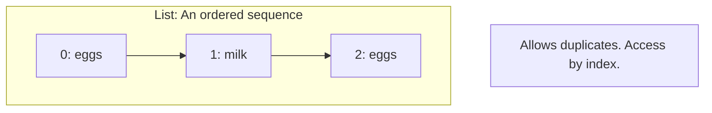
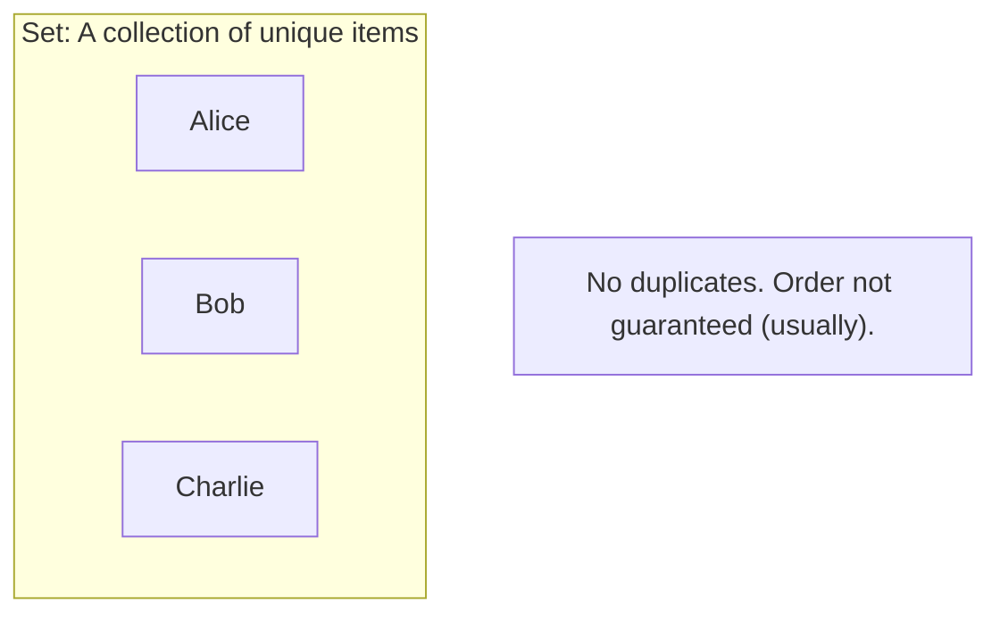
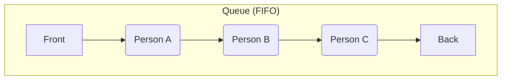
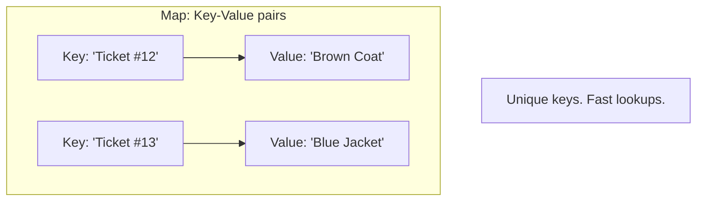
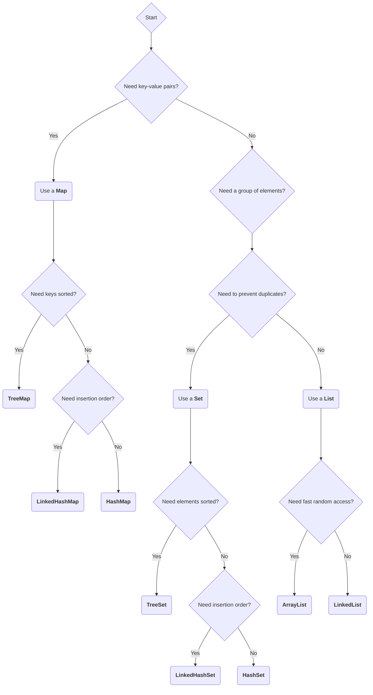
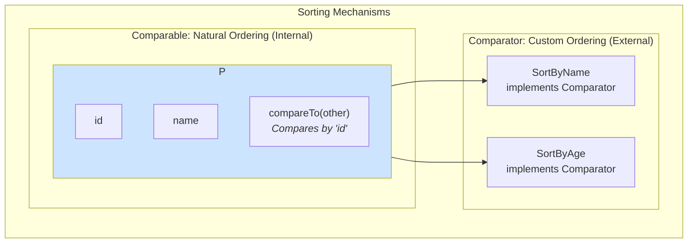

# 07 - The Java Collections Framework: A Deeper Look

We've already touched on some data structures. Now, let's look at the design philosophy behind the entire **Java Collections Framework (JCF)**. We designed it to be a unified architecture for representing and manipulating collections, enabling them to be manipulated independently of the details of their representation.

**What's in this chapter:**
*   [The JCF Hierarchy: A Map of the Tools](#1-the-jcf-hierarchy-a-map-of-the-tools)
*   [The Core Interfaces: `List`, `Set`, `Queue`, and `Map`](#2-the-core-interfaces)
*   [How to Choose the Right Collection](#3-how-to-choose-the-right-collection)
*   [Sorting: `Comparable` vs. `Comparator`](#4-sorting-comparable-vs-comparator)
*   [Your Mission: Custom Sorting](#5-your-mission-custom-sorting)

---

## 1. The JCF Hierarchy: A Map of the Tools

The cornerstone of the JCF is a set of core interfaces. Understanding this hierarchy helps you understand the capabilities of each part of the framework.

```mermaid
graph TD
    subgraph "Java Collections Framework"
        direction TB
        subgraph "Core Interfaces"
            I(Iterable)
            C(Collection)
            L(List)
            S(Set)
            Q(Queue)
            M(Map)
            I --> C
            C --> L
            C --> S
            C --> Q
        end

        subgraph "Common Implementations"
            AL(ArrayList)
            LL(LinkedList)
            HS(HashSet)
            LHS(LinkedHashSet)
            TS(TreeSet)
            PQ(PriorityQueue)
            AD(ArrayDeque)
            HM(HashMap)
            LHM(LinkedHashMap)
            TM(TreeMap)
        end

        L -- "implemented by" --> AL
        L -- "implemented by" --> LL
        Q -- "implemented by" --> LL
        S -- "implemented by" --> HS
        S -- "implemented by" --> LHS
        S -- "implemented by" --> TS
        Q -- "implemented by" --> PQ
        Q -- "implemented by" --> AD
        M -- "implemented by" --> HM
        M -- "implemented by" --> LHM
        M -- "implemented by" --> TM

        note for M "Map does not extend Collection"

        style "Core Interfaces" fill:#cde4ff
        style "Common Implementations" fill:#e1f5fe
    end
```

---

## 2. The Core Interfaces: `List`, `Set`, `Queue`, and `Map`

### `List`: An Ordered Sequence
A `List` is an **ordered** collection that allows duplicates. Think of it as a shopping list.


*   **Common Implementations:** `ArrayList`, `LinkedList`
*   **When to use:** When you need to access elements by their position and the order of elements matters.

### `Set`: A Collection of Uniques
A `Set` is a collection that contains **no duplicate** elements. Think of it as a party guest list.


*   **Common Implementations:** `HashSet`, `LinkedHashSet`, `TreeSet`
*   **When to use:** When you need to ensure that every element in the collection is unique.

### `Queue`: A First-In, First-Out Line
A `Queue` is a collection used to hold elements prior to processing, typically in a **FIFO** (first-in, first-out) manner. Think of a checkout line.


*   **Common Implementations:** `LinkedList`, `PriorityQueue`, `ArrayDeque`
*   **When to use:** When you need to process elements in the order they are added.

### `Map`: A Key-Value Store
A `Map` is an object that maps **keys to values**. Think of a coat check.


*   **Common Implementations:** `HashMap`, `LinkedHashMap`, `TreeMap`
*   **When to use:** When you need to associate a unique key with a value for fast retrieval.

---

## 3. How to Choose the Right Collection

This is a critical skill for a Java developer. Use this decision guide to help you choose.



---

## 4. Sorting: `Comparable` vs. `Comparator`

We provided two mechanisms for defining how objects are ordered.



*   **`Comparable`:** For defining the **natural order** of an object. A class implements `Comparable` itself.
*   **`Comparator`:** For defining **custom or external orderings**. A `Comparator` is implemented in a separate class.

**Key Takeaway:** If a class has a clear, single, obvious order, implement `Comparable`. For all other sorting needs, create `Comparator`s.

---

## 5. Your Mission: Custom Sorting

The code in the `code/` directory demonstrates many of the collections we've discussed. Your mission is to add a new custom sorting behavior.

1.  **Find the Code:** Open the `code/src/main/java/com/example/CollectionDemo.java` file.
2.  **Accept the Challenge:** The code already sorts the list of `Person` objects by their natural order (ID) and by name. Your task is to write the code to sort the list by age, from youngest to oldest, using a lambda expression.
3.  **Run and Verify:** Run the code (`mvn compile exec:java`) and check that the final output shows the list of people sorted by age.

<details>
<summary>Stuck? Here's the solution</summary>

```java
// Your Mission: Sort the 'people' list by age using a lambda.
people.sort((p1, p2) -> Integer.compare(p1.getAge(), p2.getAge()));
```
</details>

---

### Key Takeaways

*   **It's All About Interfaces:** The power of the JCF comes from its core interfaces (`List`, `Set`, `Map`, `Queue`). Always code to the interface, not the implementation (e.g., `List<String> names = new ArrayList<>();`).
*   **Use the Right Tool:** Use the flowchart in this chapter to guide your choice. `List` for ordered sequences, `Set` for uniqueness, `Map` for key-value lookups.
*   **`Comparable` vs. `Comparator`:** `Comparable` defines the single, natural order of an object. `Comparator` defines any number of custom, external orderings.
*   **Lambdas Make Sorting Easy:** Since Java 8, using lambda expressions to create `Comparator`s on the fly is the standard, most concise way to perform custom sorts.
