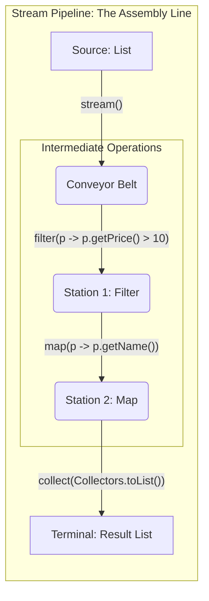
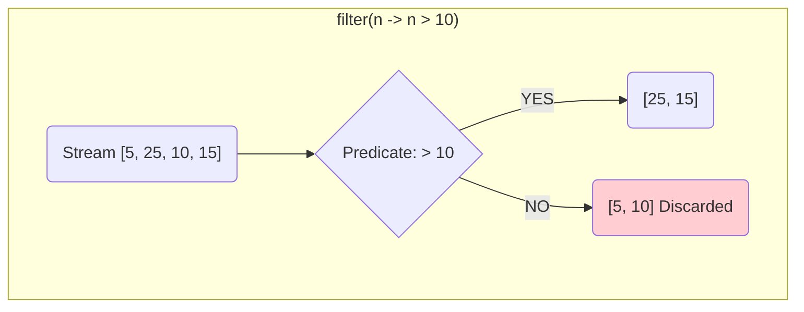
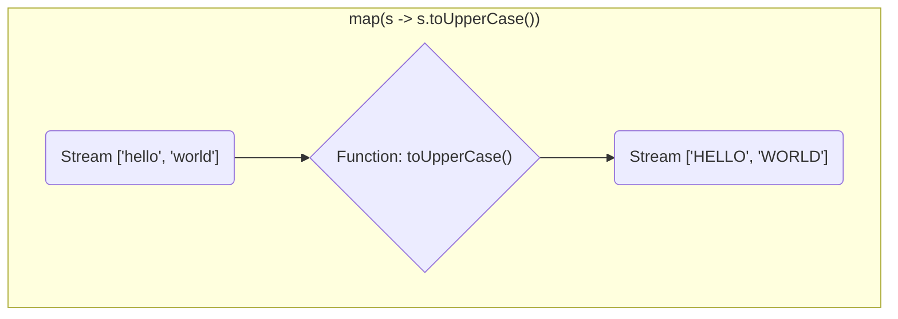
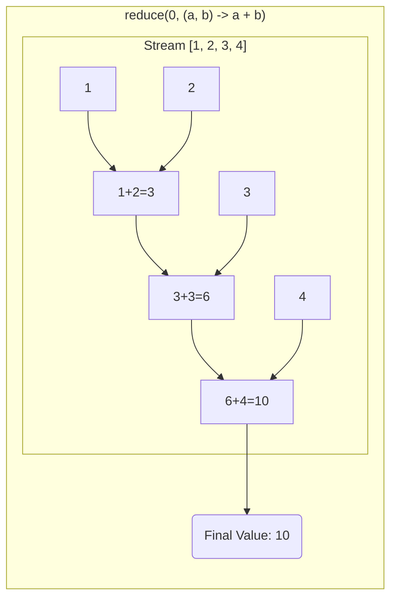

# 08a - Java Streams: Declarative Data Processing

Introduced in Java 8, the Stream API provides a powerful, declarative way to process sequences of elements. Think of it not as a data structure, but as a conveyor belt for your data.

**What's in this chapter:**
*   [The Stream Pipeline: The Assembly Line](#1-the-stream-pipeline-the-assembly-line)
*   [Core Operations: `filter`, `map`, `reduce`](#2-core-operations)
*   [Putting It All Together: A Complete Example](#3-putting-it-all-together)
*   [Creating Streams](#4-creating-streams)
*   [Parallel Streams: A Word of Caution](#5-parallel-streams-a-word-of-caution)

---

## 1. The Stream Pipeline: The Assembly Line

A stream pipeline is like an assembly line for your data. It consists of three stages:
1.  **Source:** Where the items come from (e.g., a `List`).
2.  **Intermediate Operations:** A series of stations that transform the items on the belt. These are *lazy*—they don't run until you switch the machine on.
3.  **Terminal Operation:** The final station that packages the items or produces a result. This switches the assembly line on.



---

## 2. Core Operations

Let's look at the most common stations on the assembly line.

### `filter`: The Quality Check
The `filter` operation is like a quality control station that removes items from the belt if they don't meet a certain condition.



### `map`: The Transformer
The `map` operation transforms each item on the belt into something else. It doesn't remove items; it changes them.



### `reduce`: The Combiner
The `reduce` operation is a terminal operation that combines all the items on the belt into a single result, like a final count or sum.


---

## 3. Putting It All Together

Let's see the whole pipeline in action with a real-world example.

**Goal:** From a list of products, get the names of all products that cost more than $100, in uppercase.

```java
List<Product> products = List.of(
    new Product("Laptop", 1200.00),
    new Product("Mouse", 25.00),
    new Product("Monitor", 300.00)
);

List<String> expensiveProductNames = products.stream() // 1. Source
    .filter(p -> p.getPrice() > 100.00)              // 2. Intermediate Op
    .map(p -> p.getName().toUpperCase())             // 3. Intermediate Op
    .collect(Collectors.toList());                   // 4. Terminal Op

System.out.println(expensiveProductNames); // [LAPTOP, MONITOR]
```

---

## 4. Creating Streams

Besides getting a stream from a `Collection`, you can create streams in several other ways.

| Method                       | Description                                                                    |
| :--------------------------- | :----------------------------------------------------------------------------- |
| `Stream.of(T... values)`     | Creates a stream from a sequence of objects.                                   |
| `Arrays.stream(T[] array)`   | Creates a stream from an array.                                                |
| `Stream.iterate(...)`        | Creates an infinite ordered stream (use `limit()`!).                           |
| `Files.lines(Path path)`     | Creates a stream from the lines of a file.                                     |

---

## 5. Parallel Streams: A Word of Caution

You can process a stream in parallel by calling the `.parallel()` method. This can be much faster for large datasets and complex operations.

```java
long count = products.parallelStream()
    .filter(p -> p.getPrice() > 100)
    .count();
```
**However, be careful!** Parallelism adds overhead. For simple operations or small datasets, a sequential stream is often faster. **Always measure performance** before and after using parallel streams.

---

### Key Takeaways
*   **Think in Pipelines:** View streams as an assembly line for your data: `source -> intermediate ops -> terminal op`.
*   **Focus on the "What", not the "How":** Streams are declarative. You describe what you want, and Java handles the implementation.
*   **Core Operations are Key:** Master `filter`, `map`, and `collect`, and you can handle 80% of stream use cases.
*   **Parallelism is a Tool, Not a Default:** Use parallel streams judiciously and always measure the performance impact.
