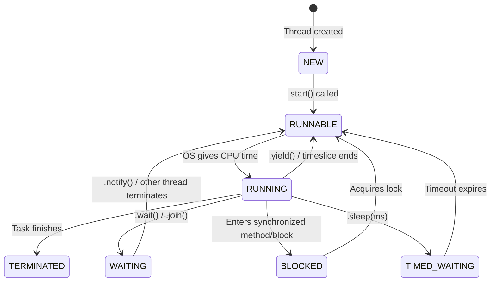
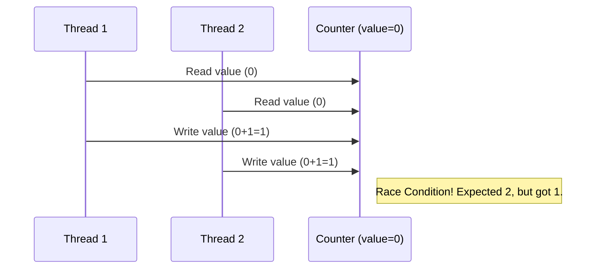
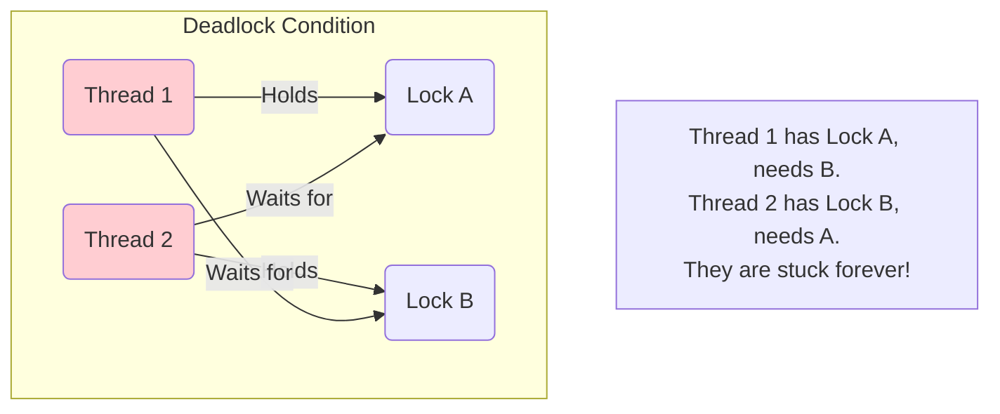
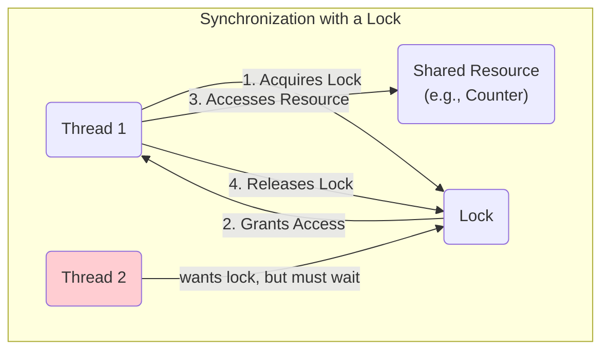
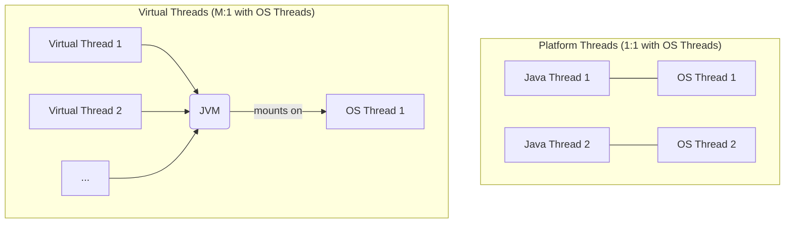

# 10 - Modern Concurrency in Java

From its inception, Java was designed for a concurrent world. Concurrency allows a program to do multiple things at once, leading to more responsive and scalable applications. While the original tools like `synchronized` were powerful, modern Java provides a much more sophisticated and efficient toolkit.

**What's in this chapter:**
*   [The Core Idea: Threads and the Lifecycle](#1-the-core-idea-threads-and-the-lifecycle)
*   [The Problem: Why Concurrency is Hard](#2-the-problem-why-concurrency-is-hard)
*   [The Classic Solution: Synchronization](#3-the-classic-solution-synchronization)
*   [The Modern Solution: The Executor Framework](#4-the-modern-solution-the-executor-framework)
*   [The Future: Virtual Threads (Project Loom)](#5-the-future-virtual-threads-project-loom)
*   [Your Mission: Fix the Race Condition](#6-your-mission-fix-the-race-condition)

---

## 1. The Core Idea: Threads and the Lifecycle

A **thread** is the smallest unit of execution in a program. A multi-threaded application is like a busy kitchen with multiple chefs working in parallel.

### The Thread Lifecycle
A thread goes through several states in its life. Understanding these states is key to debugging concurrency issues.



---

## 2. The Problem: Why Concurrency is Hard

When multiple threads access and modify shared data, you can run into serious problems.

### Race Conditions
The final result depends on the unpredictable timing of thread execution. This can lead to lost updates and corrupted data.



### Deadlocks
Two or more threads are blocked forever, each waiting for a resource that the other holds.



---

## 3. The Classic Solution: Synchronization

The original solution to these problems was the `synchronized` keyword. It provides a low-level locking mechanism to ensure **mutual exclusion** (only one thread can access a resource at a time).


While it works, `synchronized` is a blunt instrument. It can lead to performance bottlenecks. Modern Java offers better tools.

---

## 4. The Modern Solution: The Executor Framework

Manually creating and managing threads is error-prone and inefficient. The **Executor Framework**, introduced in Java 5, is the cornerstone of modern Java concurrency. It decouples task submission from task execution.

**You submit tasks, and the framework manages the threads.**

```mermaid
graph TD
    subgraph Your Application
        T1(Task 1)
        T2(Task 2)
        T3(Task 3)
    end

    subgraph ExecutorService (The Kitchen Manager)
        direction LR
        Q[Task Queue]
        subgraph Thread Pool (The Chefs)
            TH1(Thread 1)
            TH2(Thread 2)
        end
    end

    T1 --> Q
    T2 --> Q
    T3 --> Q

    Q -- "gets task" --> TH1
    Q -- "gets task" --> TH2
```
*   **`ExecutorService`:** The main interface for the framework.
*   **`Future<V>`:** When you submit a `Callable` (a task that returns a result), you get back a `Future`. It's a placeholder for a result that will be available later.

```java
ExecutorService executor = Executors.newFixedThreadPool(2);
Future<String> future = executor.submit(() -> {
    Thread.sleep(1000);
    return "Task Complete!";
});

// Do other work...

String result = future.get(); // Blocks until the result is ready
System.out.println(result);
```

---

## 5. The Future: Virtual Threads (Project Loom)

Introduced as a final feature in **Java 21**, Virtual Threads are a revolutionary change to Java concurrency.

*   **Platform Threads:** Traditional Java threads, which are wrappers around expensive OS threads. You can only have a few thousand of them.
*   **Virtual Threads:** Extremely lightweight threads managed by the JVM. You can have *millions* of them.


**Key Takeaway:** Virtual threads are the future for most high-throughput server applications in Java. `Executors.newVirtualThreadPerTaskExecutor()` is the modern way to go.

---

## 6. Your Mission: Fix the Race Condition

The code in the `code/` directory demonstrates a classic race condition. Your mission is to fix it using a modern, lock-free approach.

1.  **Find the Code:** Open `code/src/main/java/com/example/ConcurrentCounterDemo.java`.
2.  **Locate the `UnsafeCounter` class:** This is the class with the bug.
3.  **Accept the Challenge:** Modify the `UnsafeCounter` to make it thread-safe by changing the `int` field to an `AtomicInteger` and updating the methods.
4.  **Run and Verify:** Run the code before and after your changes to see the difference.

<details>
<summary>Stuck? Here's the solution</summary>

```java
// The fixed counter class
static class SafeCounter {
    // 1. Use AtomicInteger
    private AtomicInteger count = new AtomicInteger(0);

    public void increment() {
        // 2. Use the atomic incrementAndGet() method
        count.incrementAndGet();
    }

    public int getCount() {
        // 3. Use the get() method
        return count.get();
    }
}
```
</details>

---

### Key Takeaways

*   **Concurrency is Hard:** Race conditions and deadlocks are subtle. Always use the modern concurrency utilities.
*   **Use the Executor Framework:** Don't manage threads manually. Decouple task submission from execution using an `ExecutorService`.
*   **Prefer Atomic Classes over Locks:** For simple atomic operations like incrementing a counter, `AtomicInteger` is much more efficient than using `synchronized`.
*   **Virtual Threads are the Future:** For I/O-bound tasks, `Executors.newVirtualThreadPerTaskExecutor()` (Java 21+) is a game-changer.
