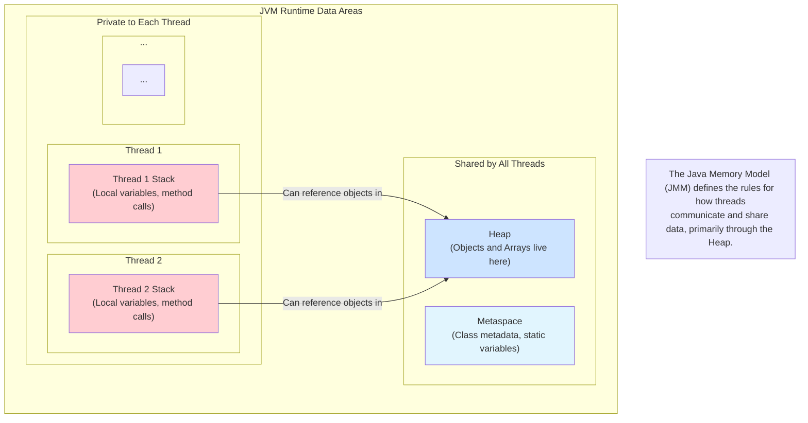
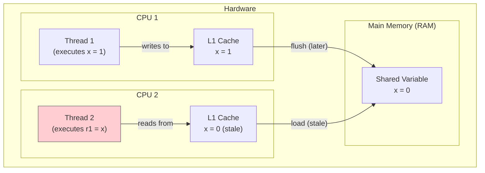

# 11 - The Java Memory Model: The Rules of Concurrency

The Java Memory Model (JMM) is the specification that defines the rules for how threads interact with memory. Understanding it is essential for writing correct, high-performance concurrent code.

First, let's distinguish between the JVM's **Memory Structure** (where data lives) and the **Memory Model** (the rules of communication).

### The JVM's Memory Structure
This is the "map" of memory within the JVM.



**What's in this chapter:**
*   [The Problem: Why the JMM is Necessary](#1-the-problem-why-the-jmm-is-necessary)
*   [The Solution: The "Happens-Before" Guarantee](#2-the-solution-the-happens-before-guarantee)
*   [The `volatile` Keyword: A Lightweight Guarantee](#3-the-volatile-keyword-a-lightweight-guarantee)
*   [Your Mission: Guarantee Visibility](#4-your-mission-guarantee-visibility)

---

## 1. The Problem: Why the JMM is Necessary

In a modern computer, to improve performance, each CPU core has its own local cache. This creates a problem: a change made by one thread in its cache might not be visible to other threads.

**The Analogy: Chefs with Personal Refrigerators**
Imagine a kitchen with a pantry (Main Memory) and chefs (CPU Cores), each with their own personal fridge (CPU Cache).
1.  Chef 1 gets butter from the pantry and puts it in their personal fridge.
2.  Chef 1 uses some butter (modifies the variable `x=1`).
3.  Chef 2 goes to the pantry to get butter. They get the old, unchanged butter because Chef 1 hasn't put their updated butter back yet. This is a **visibility problem**.



---

## 2. The Solution: The "Happens-Before" Guarantee

The JMM provides a formal guarantee called **happens-before**. It's a simple rule:
> If action A *happens-before* action B, then the results of A are guaranteed to be visible to and ordered before B.

Several things create a happens-before relationship:
*   A `synchronized` lock release *happens-before* every subsequent acquire of that same lock.
*   A write to a `volatile` variable *happens-before* every subsequent read of that same `volatile` variable.
*   Calling `thread.start()` *happens-before* any action in the started thread.
*   A thread finishing *happens-before* another thread returns from `thread.join()`.

**The Analogy: A Relay Race Baton Pass**
A `synchronized` block or a `volatile` write acts like a baton pass in a relay race. It's a synchronization point that guarantees all of the previous runner's work is complete and visible before the next one begins.

---

## 3. The `volatile` Keyword: A Lightweight Guarantee

The `volatile` keyword is a weaker form of synchronization. It does **not** provide locking, but it **does** provide a visibility guarantee.

When you declare a variable `volatile`, you are telling the JVM:
1.  Every write to this variable must be flushed directly to main memory.
2.  Every read of this variable must come directly from main memory.

**The Analogy: A Megaphone Announcement**
A `volatile` variable is like a chef making an announcement on a megaphone. Any thread that changes it is forced to announce the new value to the whole kitchen. Any thread that needs the value is forced to listen for the announcement.

```mermaid
graph TD
    subgraph "Thread 1 (Writer)"
        A("writes volatile flag") --> B["Flush to Main Memory"];
    end
    subgraph "Thread 2 (Reader)"
        C("reads volatile flag") <-- D["Read from Main Memory"];
    end

    B --> MainMemory[Main Memory<br>(volatile boolean stopped)]
    MainMemory --> D
```
**When to use it:** Use `volatile` for simple status flags where one thread writes and other threads read (e.g., `volatile boolean stopped`). It does **not** solve race conditions like `i++`.

---

## 4. Your Mission: Guarantee Visibility

The code in the `code/` directory contains a `Worker` thread that runs in a loop, controlled by a `stopped` flag. Without a visibility guarantee, the worker may never see the main thread's change to the flag and could loop forever.

**Your Mission:**

1.  **Find the Code:** Open `code/src/main/java/com/example/VisibilityDemo.java`.
2.  **Analyze the Problem:** Notice the `stopped` boolean field. It's a classic status flag that needs a visibility guarantee.
3.  **Accept the Challenge:** Add the `volatile` keyword to the declaration of the `stopped` field.
4.  **Run and Verify:** Run the code before and after your change. With `volatile`, the program should now reliably terminate within a second.

<details>
<summary>Stuck? Here's the solution</summary>

```java
// Add the volatile keyword to the field declaration
private volatile boolean stopped = false;
```
</details>

---

### Key Takeaways

*   **Concurrency has "Hidden" Problems:** In a multi-threaded world, you can't assume that a write in one thread will be seen by another.
*   **The JMM Provides Guarantees:** The JMM is the formal specification that gives you predictable rules. The most important rule is the **happens-before** guarantee.
*   **Use Synchronization for Guarantees:** Actions like `synchronized`, `volatile`, and `join()` create `happens-before` relationships.
*   **`volatile` is for Visibility, Not Atomicity:** `volatile` is perfect for status flags but does **not** protect against race conditions like `i++`. For that, you need `AtomicInteger` or `synchronized`.
