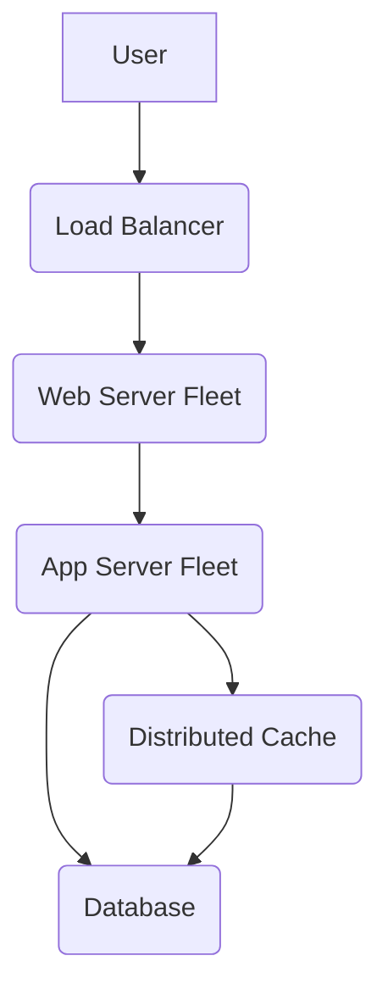
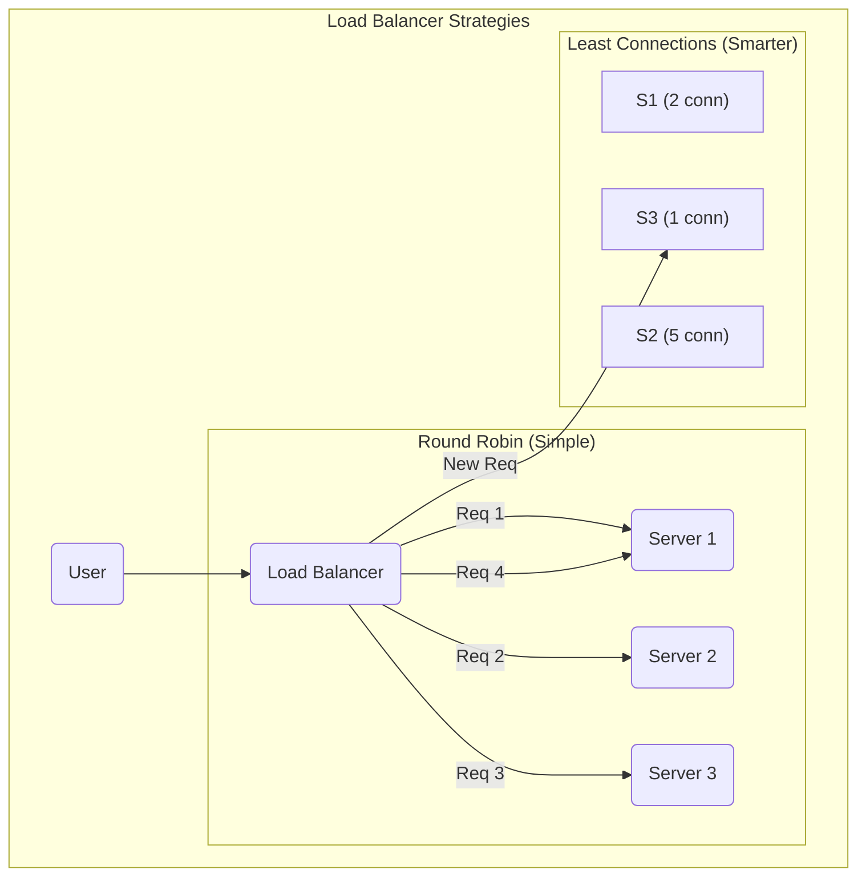
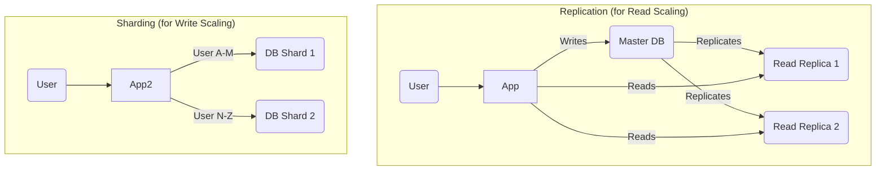
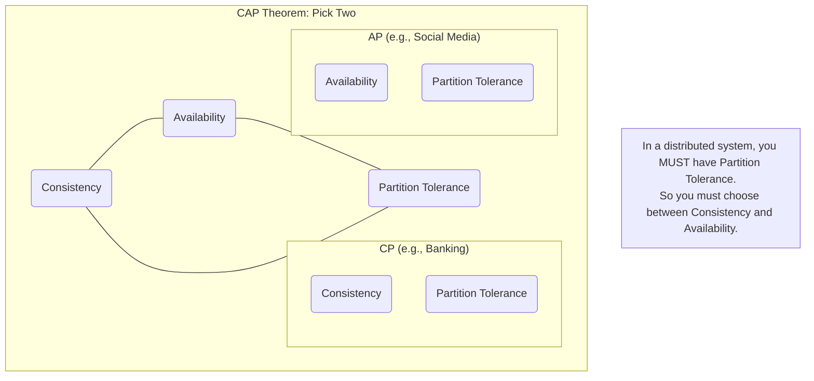
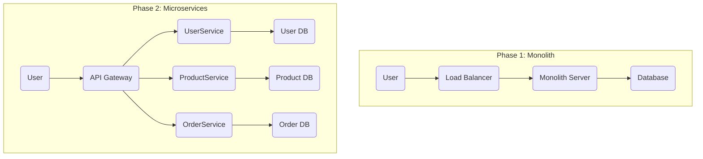

# 12 - System Design with Java: Building Large-Scale Systems

We designed Java to build robust, large-scale systems. This chapter explores *why* Java is an excellent choice for system design and provides a framework for thinking about architectural problems.

**What's in this chapter:**
*   [A Framework for System Design Interviews](#1-a-framework-for-system-design-interviews)
*   [Deep Dive: Core System Design Building Blocks](#2-deep-dive-core-system-design-building-blocks)
*   [Architectural Patterns: Monolith vs. Microservices](#3-architectural-patterns-monolith-vs-microservices)
*   [Your Mission: Design a URL Shortener](#4-your-mission-design-a-url-shortener)

---

## 1. A Framework for System Design Interviews

System design interviews test your ability to handle ambiguity and make reasoned trade-offs. Following a structured approach is key.

**Step 1: Clarify Requirements (Functional & Non-Functional)**
*   **Functional:** What must the system do? (e.g., "Design a URL shortener.")
*   **Non-Functional:** What are the constraints? Ask about **scale** (users, requests per second), **latency**, and **availability**.

**Step 2: High-Level Design (The Whiteboard Sketch)**
Draw the main components. Start simple.


**Step 3: Deep Dive into a Component**
The interviewer will guide you. Be prepared to discuss database choice, API design, or scaling strategy.

**Step 4: Articulate Trade-offs**
Always explain the "why" behind your decisions and acknowledge the downsides. (e.g., "I'm adding a cache to reduce latency, but the trade-off is potential data inconsistency.")

---

## 2. Deep Dive: Core System Design Building Blocks

### Load Balancing
Distributes incoming traffic across multiple servers.



### Caching
Stores frequently accessed data in a fast, in-memory layer to reduce latency and database load.

```mermaid
sequenceDiagram
    participant App
    participant Cache
    participant DB

    box "Cache-Aside (Lazy Loading)"
    App->>Cache: Read data?
    Cache-->>App: Not found
    App->>DB: Read data
    DB-->>App: Return data
    App->>Cache: Write data
    end

    box "Read-Through"
    App->>Cache: Read data?
    Note over Cache: Cache is responsible<br>for fetching from DB
    Cache->>DB: Read data
    DB-->>Cache: Return data
    Cache-->>App: Return data
    end
```

### Database Scaling
*   **Replication (Scaling Reads):** Create copies of the database. Writes go to the master, reads go to the replicas.
*   **Sharding (Scaling Writes):** Partition the data across multiple databases. Each database holds a subset of the data.



### The CAP Theorem
For a distributed data store, you can only pick two out of three guarantees: Consistency, Availability, and Partition Tolerance.


---

## 3. Architectural Patterns: Monolith vs. Microservices

A common path for a successful system is to evolve from a simple monolith to a more complex but scalable microservice architecture.


*   **Monolith:** Simpler to develop and deploy initially. Best for new projects and small teams.
*   **Microservices:** More scalable and allows for team autonomy, but at the cost of much higher operational complexity.

---

## 4. Your Mission: Design a URL Shortener

Apply the 4-step framework to design a service like TinyURL.

1.  **Clarify Requirements:** Functional (shorten, redirect) and non-functional (scale, latency).
2.  **High-Level Design:** Draw the components. What are the APIs? (`POST /shorten`, `GET /{alias}`).
3.  **Deep Dive:** How do you generate the alias? (e.g., base62-encoded counter). What's the DB schema?
4.  **Articulate Trade-offs:** What are the bottlenecks? (e.g., write contention on the counter). How do you scale reads? (e.g., caching).
