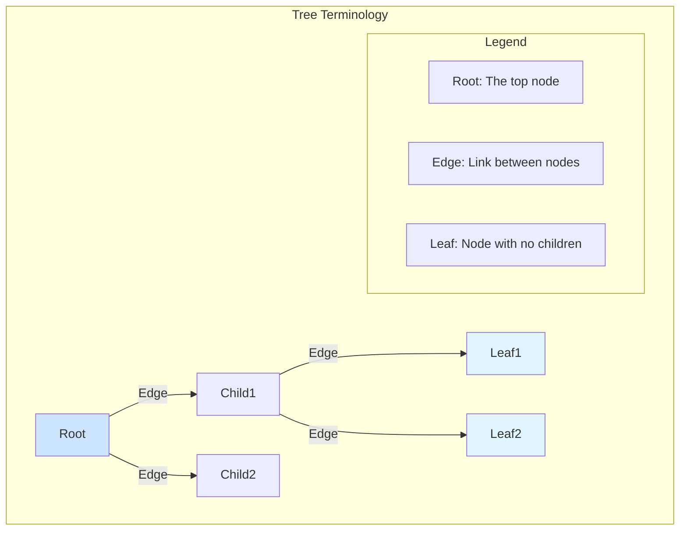
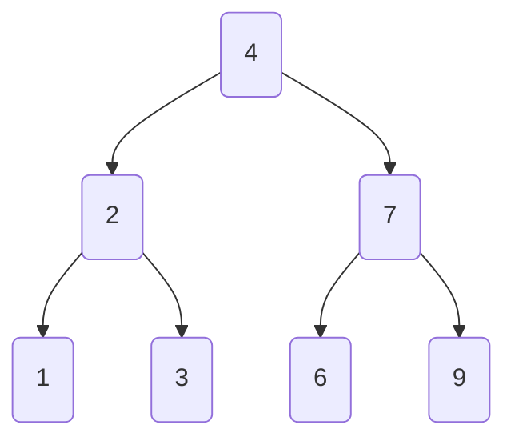
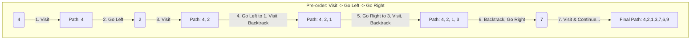
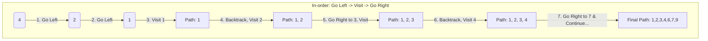
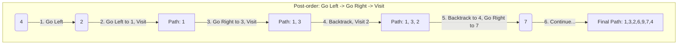
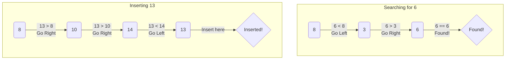
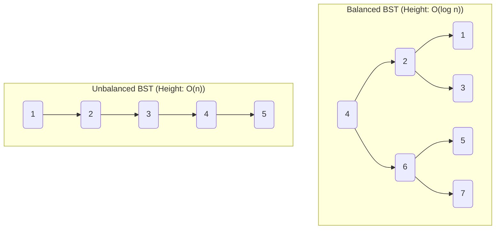

# 20 - Trees: Representing Hierarchical Data

Trees are a fundamental non-linear data structure used to represent hierarchical data. Think of a family tree, an organization chart, or the file system on your computer—these are all tree structures.

**What's in this chapter:**
*   [Binary Trees and Traversals](#1-binary-trees-and-traversals)
*   [Binary Search Trees (BST)](#2-binary-search-trees-bst)
*   [Balanced vs. Unbalanced Trees](#3-balanced-vs-unbalanced-trees)
*   [Hands-On Lab: Building and Traversing a Tree](#4-hands-on-lab)

---

## 1. Binary Trees and Traversals

A **Binary Tree** is a tree in which each node has at most two children, referred to as the `left` child and the `right` child.

### Our Example Tree
Let's use this simple binary tree to demonstrate the traversal algorithms.

**Traversal** is the process of visiting every node in the tree exactly once. The order in which you visit them defines the traversal type.

### Pre-order Traversal (Root, Left, Right)
Visits the current node **before** its children. Useful for creating a copy of a tree.

### In-order Traversal (Left, Root, Right)
Visits the current node **in-between** its left and right children. For a Binary Search Tree, this visits the nodes in sorted order.

### Post-order Traversal (Left, Right, Root)
Visits the current node **after** its children. Useful for deleting nodes from a tree (you delete the children before the parent).

---

## 2. Binary Search Trees (BST)

A **Binary Search Tree** is a special type of binary tree with a crucial property:
> For any given node, all values in its **left** subtree are **less than** the node's value, and all values in its **right** subtree are **greater than** the node's value.

This property makes searching for and inserting elements incredibly efficient, with an average time complexity of **O(log n)**.

---

## 3. Balanced vs. Unbalanced Trees

The O(log n) performance of a BST depends on it being **balanced**. If you insert sorted elements into a BST, it becomes a completely unbalanced tree, which is just a linked list. Performance degrades to O(n).

**Self-Balancing Trees:** Special types of BSTs, like **AVL trees** and **Red-Black trees**, automatically perform rotations during insertion and deletion to keep the tree balanced. Java's `TreeMap` and `TreeSet` are implemented using Red-Black trees.

---

## 4. Hands-On Lab

We've created a runnable project in the `code/` directory that builds the example tree and implements all four traversal algorithms. Explore the source code to see how they are implemented.

**To run it:**
1.  Navigate to the `code/` directory.
2.  Run `mvn compile exec:java`.
