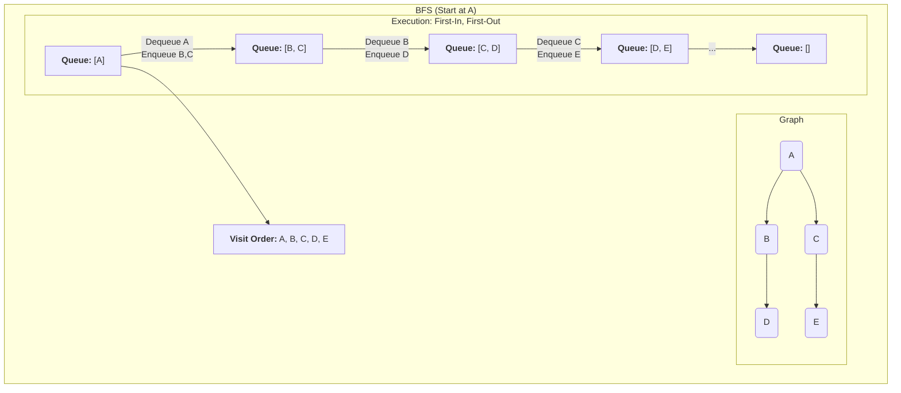
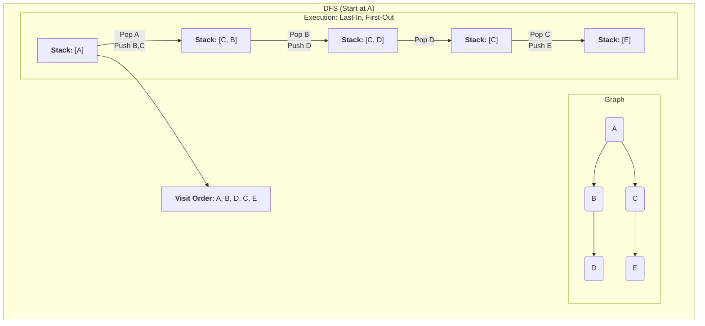

# 21 - Graphs: Modeling a Connected World

If trees represent hierarchies, graphs represent networks. A graph is a data structure used to model relationships between objects. Social networks, road maps, the internet itself—these are all graphs.

**What's in this chapter:**
*   [How to Represent a Graph](#1-how-to-represent-a-graph)
*   [Graph Traversal: BFS and DFS](#2-graph-traversal-bfs-and-dfs)
*   [Hands-On Lab: Building and Traversing a Graph](#3-hands-on-lab)

---

## 1. How to Represent a Graph

There are two common ways to represent a graph in code. Choosing the right one depends on the graph's density (how many edges it has).

```mermaid
graph TD
    subgraph "The Graph"
        A("A") --- B("B")
        A --- C("C")
        B --- D("D")
    end

    subgraph "Adjacency Matrix (V² space)"
        direction LR
        M0[" "]
        M1["A B C D"]
        M2["A: 0 1 1 0"]
        M3["B: 1 0 0 1"]
        M4["C: 1 0 0 0"]
        M5["D: 0 1 0 0"]
        note for M5 "<b>Pros:</b> Fast edge lookup (O(1))<br><b>Cons:</b> Wastes space for sparse graphs"
    end

    subgraph "Adjacency List (V+E space)"
        direction TB
        L1["A: [B, C]"]
        L2["B: [A, D]"]
        L3["C: [A]"]
        L4["D: [B]"]
        note for L4 "<b>Pros:</b> Space efficient<br><b>Cons:</b> Slower edge lookup"
    end
```
**Conclusion:** The **Adjacency List** is the most common and generally preferred representation because most real-world graphs are sparse.

---

## 2. Graph Traversal: BFS and DFS

Traversal means visiting every vertex in a graph. The two fundamental algorithms for this are Breadth-First Search (BFS) and Depth-First Search (DFS).

### Breadth-First Search (BFS): The Wave
BFS explores the graph layer by layer, like ripples in a pond. It uses a `Queue` to keep track of the next nodes to visit. This is perfect for finding the **shortest path** in an unweighted graph.



### Depth-First Search (DFS): The Maze Solver
DFS explores as far as possible along each branch before backtracking, like a maze solver always turning right. It uses a `Stack` (or recursion). This is great for checking connectivity and finding cycles.



---

## 3. Hands-On Lab

We've created a runnable project in the `code/` directory that implements a `Graph` class using an adjacency list and demonstrates both BFS and DFS traversals.

**To run it:**
1.  Navigate to the `code/` directory.
2.  Run `mvn compile exec:java`.
3.  Explore the source code to see how the graph is built and traversed.
